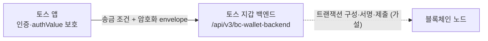
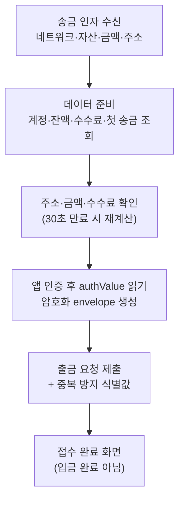
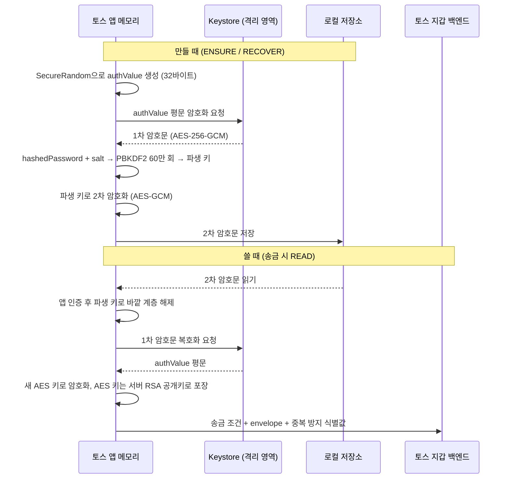
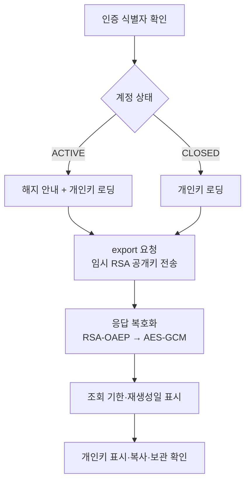

# 토스 코인지갑 앱 기능 정리 (flow 포함)

- **출처:** `261116_toss_wallet_analysis.pdf` (토스 코인지갑 구현·키 관리·출시 전략 분석, Toss Android 5.284.0 정적 분석)
- **표기 규칙:** 표기가 없는 항목은 분석 보고서가 앱 코드에서 확인한 내용이다. 추측이나 추론은 문장 끝에 **(가설)** 로 표시했다. 다이어그램에서는 실선=확인, 점선=가설이다.
- **주의:** "확인"은 앱을 실행해 본 결과가 아니라 코드를 읽어 확인한 결과다.

## 핵심 요약

- 토스 앱(5.284.0)에 코인지갑 기능이 이미 들어 있다: 송금, 로컬 인증값 관리, 개인키 내보내기, 지갑 해지·재생성 안내.
- 출금은 앱이 직접 서명하지 않고, 송금 조건과 암호화한 인증값을 서버에 보내 서버가 처리하는 구조다.
- 서버의 키 생성·보관·서명 방식, 국내 출시 여부는 이 APK만으로는 확정할 수 없다.

### 전체 구조

## 1. 서버 쪽 동작

- 서버가 TEE(격리 실행 환경) 기반 키 관리 장치에서 키를 보관하고 서명한다. **(가설)** 근거는 `bc-tee-kms`라는 이름이다.
  - 이 이름은 개인키 내보내기 코드에 들어 있는 문자열 `bc-tee-kms/privkey-export/v2`에서 나왔다.
  - 앱은 서버가 보낸 개인키를 AES-GCM으로 풀 때 이 문자열을 추가 인증 데이터(AAD)로 넣는다. AAD는 암호문에 함께 묶여 검증되는 꼬리표 값으로, 서버와 앱이 같은 값을 써야 복호화가 된다.
  - 이름은 "블록체인(bc) TEE 키 관리 시스템(kms)의 개인키 내보내기 v2"로 읽힌다. 개인키 내보내기 경로에서만 나온 문자열이며, 일반 출금이 같은 장치를 쓴다는 증거는 아니다.
- 앱은 토스 지갑 백엔드(`/api/v3/bc-wallet-backend`)와만 통신한다. 계정, 네트워크, 자산, 수수료, 출금, 개인키 내보내기가 모두 이 경로를 거친다.
- 서버는 인증값을 암호화할 공개키를 앱에 내려 준다.
- 출금 요청을 받으면 접수 식별값을 돌려준다. 거래 해시나 확정 결과를 돌려주지는 않는다.
- 실제 거래를 만들고 서명해 블록체인에 올리는 일은 서버가 한다. **(가설)**
- 인증값은 서버가 지갑 키 사용을 허가하는 수단이다. **(가설)**
- 자산 선택, 금액 입력, 가입 같은 앞단 화면은 웹 화면에 따로 있고, 앱은 확인·인증·개인키 조회를 맡는다. **(가설)**
- 앱에 기능을 먼저 넣어 두고 서버에서 공개 범위를 조절한다. **(가설)**

## 2. 계정·자산 정보 조회

- 내 지갑 계정의 상태(활성/해지), 주소, 개인키 조회 기한을 서버에서 받아온다.
- 지원 네트워크 목록과 네트워크별 자산 목록을 받아온다.
- 잔액과 가격도 서버에서 받아온다.
- EVM 계열 네트워크와 토큰(ERC-20 등)을 지원한다. **(가설)** 근거는 관련 데이터 항목(`evmChainId`, `contractAddress`)이다.

## 3. 코인 송금(출금)

- **금액 입력 단위:** 코인 수량 또는 원화 금액으로 보낼 수 있다. 원화로 넣으면 서버가 필요한 코인 수량을 계산해 준다.
- **받는 사람 표시:** 지갑 주소, 주소 별칭, 연락처 이름·번호를 보여 준다. "연락처와 연결된 지갑 주소를 불러왔어요"라는 문구가 있다.
- **잔액 확인:** 보낼 수 있는 금액인지 서버에 확인한다.
- **수수료 안내:** 예상 수수료와 최대 수수료를 원화 환산값과 함께 보여 주고, 최대치를 넘지 않는다고 안내한다.
- **주소 확인:** "처음 보내는 주소"를 표시하고, 주소 재확인 창을 띄운다. "다음 송금부터는 안내를 안볼게요"로 끌 수 있다.
- **재계산:** 화면에 띄운 정보는 30초가 지나면 만료되어, 가격이 바뀌었다며 금액을 다시 계산하게 한다.
- **본인 인증 후 요청:** 앱 인증을 거친 뒤 송금 조건과 암호화한 인증값을 서버에 보낸다. 중복 요청 방지용 식별값도 함께 보낸다.
- **접수 완료 화면:** "송금 요청을 완료했어요", "완료되면 알려드릴게요"를 보여 준다. 요청 접수를 뜻하며 입금 완료와는 다르다.
- 입금이 완료되면 알림을 보낸다. **(가설)** 근거는 안내 문구다.

## 4. 로컬 인증값 관리

- 기기에 저장된 인증값의 상태를 확인한다: 있음 / 없음 / 손상됨.
- 인증값을 준비하거나(없으면 새로 생성), 읽거나, 복구한다(손상 시 새 값으로 대체).
- 인증값은 앱이 만든 32바이트 난수이며, 기기 보안 저장소 키와 비밀번호에서 만든 키로 두 번 암호화해 저장한다.
- 서버로 보낼 때는 매번 새 암호화 키로 감싸서 보낸다.

- authValue 평문은 앱 메모리에만 있다. Keystore는 authValue가 아니라 authValue를 잠그는 AES-256 키만 보관하며, 이 키는 밖으로 나오지 않는다.
- 1차 보호는 Keystore AES-256 키(alias `blockchain-wallet-auth-value-key`), 2차 보호는 PBKDF2-HMAC-SHA256(600,000회)로 만든 비밀번호 파생 키다. 복호화는 역순으로 한다.
- 이중 암호화는 하나의 값에 암호화를 두 번 차례로 적용하는 것이다. 풀려면 두 키가 모두 있어야 한다. 값을 둘로 쪼개는 키 분할(MPC)과는 다르며, 보고서도 분할 연산은 확인되지 않았다고 적었다.
- 2차 암호문은 `blockchainWallet` / `authValueProtectedBlob`에 저장한다.
- 코드에서 Keystore를 쓴다는 것까지만 확인됐다. 실제 기기에서 키가 하드웨어 격리 영역에 들어가는지는 보고서가 관찰하지 못했다.

## 5. 개인키 내보내기

- 본인 확인을 거쳐 받은 인증 식별자가 있어야 진입할 수 있다.
- 서버가 암호화해 보낸 개인키를 앱에서 풀어 화면에 보여 준다.
- 복사하기 버튼이 있고, 복사 성공·실패를 알려 준다.
- "개인키를 별도로 보관했어요" 확인 버튼으로 마친다.
- 조회 가능 기한을 안내한다: "○월 ○일까지 본인 확인 후 볼 수 있어요", "기간이 지나면 다시 볼 수 없어요".
- 화면을 벗어나면 메모리에 있던 개인키를 지우려고 시도한다.
- 내보낸 키로 토스 밖에서 자산을 독립적으로 쓸 수 있다. **(가설)**

## 6. 지갑 해지·재생성 안내

- 활성 계정이면 "토스 코인지갑을 해지하고 있어요" 문구와 함께 개인키를 불러온다.
- 이미 해지된 계정도 개인키를 다시 볼 수 있게 처리한다.
- 재생성 가능일을 안내한다. 개인키 조회 기한의 다음 날로 계산한다.
- 개인키 내보내기는 지갑을 해지하면서 키를 가져가는 절차다. **(가설)**

## 7. 대상 지역

- 출금 화면의 허용 지역으로 한국·호주·EU가 등록되어 있다.
- 국내 사용자를 대상으로 한 기능이다. **(가설)** 근거는 원화 입력, 한국어 문구, 한국 지역 등록이며, 분석 보고서는 "강하게 지지"로 판정했다.
- 호주·EU로 확장할 계획이다. **(가설)**
